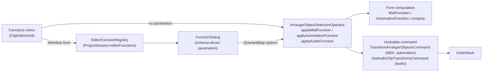

<!---
SPDX-FileCopyrightText: © 2026 Alexandros Theodotou <alex@zrythm.org>
SPDX-License-Identifier: FSFAP
-->

# Editor Functions

Transformative functions in the clip editors (MIDI, audio, automation):
Crescendo, Flam, flips, Legato/Portato/Staccato, Strum for MIDI notes;
Invert, Normalize, fades and Reverse for audio; Flip H/V and Flatten for
automation points. Every function is a single undo step and is driven by a
declarative registry that also describes its parameter dialog.

## Architecture

The layers keep concerns separate:

- **Registry** (`gui/backend/editor_function_registry.{h,cpp}`): each
  function is an `EditorFunctionDefinition` with an id, label, family,
  enum value, minimum selection count and a list of typed parameters
  (integer/double/boolean/choice). The QML Functions menu and the generic
  `FunctionDialog` are generated from these definitions; no per-function UI
  code exists. Last-used parameter values are remembered per function id in
  `AppSettings.editorFunctionLastParams`.
- **Pure computation** (`structure/arrangement/{midi,automation}_function.*`):
  `compute()` derives target states from the input without mutating
  anything. This makes the result snapshottable and testable without an
  undo stack.
- **Operator** (`actions/arranger_object_selection_operator.*`): extracts
  the selected objects, parses the option map, computes the result, skips
  no-ops (nothing is pushed when nothing changes) and pushes the command.
  Functions that add objects (Flam) clone the grace notes and push one add
  command per note inside a macro, so a failed clone refuses the whole
  operation.
- **Commands** (`commands/`): `TransformArrangerObjectsCommand` writes
  absolute before/after snapshots (idempotent undo/redo). Audio functions
  push `SetAudioClipTransformsCommand`, a before/after snapshot of the
  clip's transform list.

## MIDI and automation

`MidiFunction::compute` returns per-note target states (position, length,
pitch, velocity) plus any notes to add; `AutomationFunction::compute`
returns per-point states (position, value, curve algorithm, curviness).
Both are captured by `TransformableObjectState` and written by
`TransformArrangerObjectsCommand`.

## Audio

Audio functions (Invert, Normalize Peak/RMS, Fade In/Out, Reverse) are
**non-destructive**: applying a function appends one parametric transform
entry — an operation over a content-tick range — to the clip's ordered
transform list, and playback/waveform rendering evaluates the list. Fade
functions require a selected range; the other functions default to the
clip's audible span, clamped at the loop end for looped clips. The clip's
edge fade system (`fadeRange`) is separate; the Fade In/Out functions are
entries like the others, not writes to `fadeRange`.

## Adding a function

1. Implement it with tests, in the family's pure-compute function (MIDI,
   automation) or as an audio transform entry kind: the kind struct, its
   variant entry and its id in the project schema's kind enum
   (`data/schemas/common.schema.json`).
2. Add an `EditorFunctionDefinition` with its parameters to
   `EditorFunctionRegistry`'s constructor.
3. If it introduces options or object changes beyond the existing command
   fields, extend `TransformableObjectState` accordingly.
