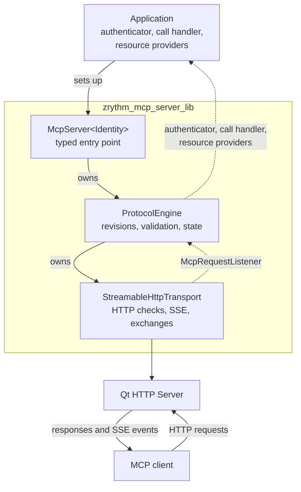
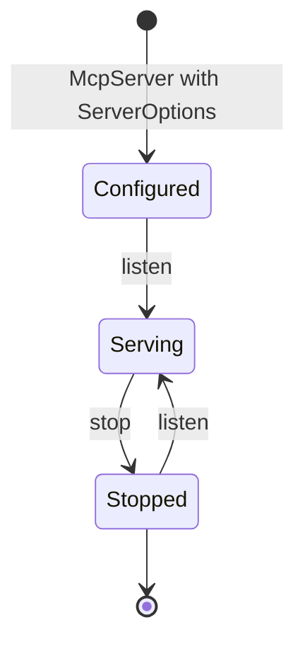
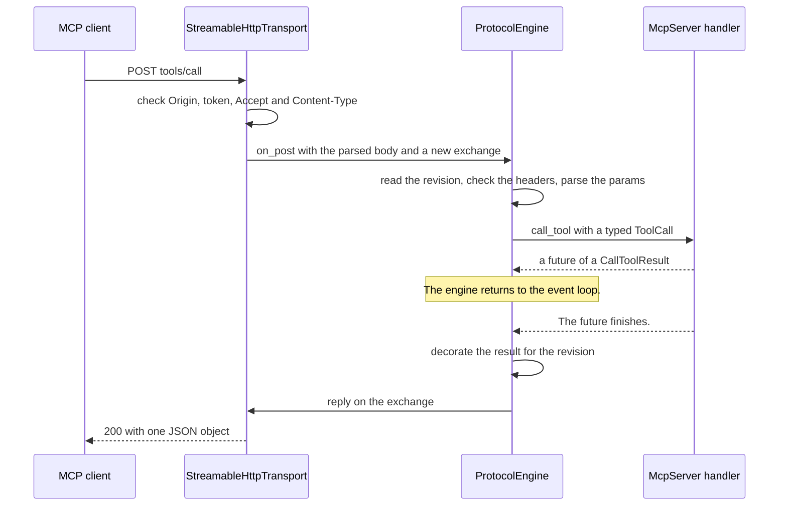

<!---
SPDX-FileCopyrightText: © 2026 Alexandros Theodotou <alex@zrythm.org>
SPDX-License-Identifier: FSFAP
-->

# MCP Server Library

This document describes `zrythm_mcp_server_lib`, the standalone library
in [`src/frontends/mcp/mcpserver/`](../../src/frontends/mcp/mcpserver/)
that serves the Model Context Protocol (MCP) over Streamable HTTP. The
library holds no application code. The application that uses it
supplies an authenticator, its tools with their call handler, and any
number of resource providers.

## Overview

The library is a static library that depends on Qt (Core, Network,
HttpServer), nlohmann json and `zrythm::utils_lib`. Its users include
its headers as `<mcpserver/...>`. It has three layers, and each one
owns the layer below it.

- **`McpServer<Identity>`** is the entry point. `Identity` is the type
  that the authenticator returns for a request. The class wraps the
  authenticator and the call handler of the application into the
  erased handlers of the engine, so a call handler of another identity
  type does not compile.
- **`ProtocolEngine`** is the protocol core. It reads the revision of
  a request, validates the message, dispatches it, keeps the state of
  the exchanges, streams and sessions, and decorates the results. It
  holds the identity of a request as an erased value and passes it
  back to the handlers.
- **`StreamableHttpTransport`** serves the endpoint on Qt HTTP Server.
  It makes the checks that need no protocol knowledge, creates one
  `HttpExchange` per request, encodes server-sent events, and reports
  each request to the engine through the `McpRequestListener`
  interface.

The public headers of the library:

| Header | Contents |
|---|---|
| [`json_rpc.h`](../../src/frontends/mcp/mcpserver/json_rpc.h) | The JSON-RPC 2.0 envelope: the request, notification and error types, and the parser, which returns an error response for any malformed message. |
| [`mcp_types.h`](../../src/frontends/mcp/mcpserver/mcp_types.h) | The MCP data types: `ProtocolRevision`, `RevisionPolicy`, `ServerCapabilities`, `Tool`, `CallToolResult`, `Resource`, `ResourceUri`, `SubscriptionFilter`. |
| [`resource_provider.h`](../../src/frontends/mcp/mcpserver/resource_provider.h) | The `ResourceProvider` interface. |
| [`protocol_engine.h`](../../src/frontends/mcp/mcpserver/protocol_engine.h) | `ProtocolEngine`, `ServerOptions` and `ServerLimits`. |
| [`mcp_server.h`](../../src/frontends/mcp/mcpserver/mcp_server.h) | `McpServer<Identity>`, the typed entry point. |
| [`http_request.h`](../../src/frontends/mcp/mcpserver/http_request.h) | `HttpRequest` and `HttpMethod`, which the authenticator receives. |

`McpServer<Identity>` is a template that holds the `ProtocolEngine` by
value, so `protocol_engine.h` is public as well. An application uses
the engine through `McpServer` only. The private headers are
`http_exchange.h` and `streamable_http_transport.h` of the HTTP layer,
and `mcp_methods.h`, which holds the types of one request.

Every type parses what a client sends in its `from_json` function and
writes what the server sends in its `to_json` function, so the server
passes typed values. The capabilities of a client, the arguments of a
tool call and the schema of a tool stay `Json`, because the server does
not interpret them. Parsing a message that comes from a client returns
an error value, so a malformed message becomes an error response.

## Life cycle

1. The application constructs `McpServer<Identity>` with
   `ServerOptions`, sets the authenticator, adds its tools, sets the
   call handler, and adds its resource providers. A tool definition is
   validated when it is parsed into a `Tool`, and `add_tool` refuses a
   second tool with the same name.
2. `listen ()` starts to serve on the address and port. The port 0
   chooses a free port, which `listening_port ()` then reports.
   `listen ()` returns a `ListenError` when the server has no
   authenticator, when it has tools but no call handler, when two
   providers serve the same URI, when `max_connections` covers fewer
   connections than the limits on streams and sessions allow, or when
   the TCP server could not listen on the address. The error holds the
   message and, in the last case, the socket error of the TCP server.
3. `stop ()` ends every stream and session and stops serving. The
   server can listen again afterwards.

All functions of the server and of the engine run on the thread that
owns the object. The call handler and `ResourceProvider::read ()`
return a `QFuture` that may finish on any thread. The signals of a
provider may come from any thread, and the engine calls `resources ()`
and `read ()` on its own thread.

## Protocol revisions

The MCP specification is published in dated revisions. A revision in
this document is one dated version of that specification. The server
speaks two. A request names its revision in the `MCP-Protocol-Version`
header, and a request without the header belongs to `2025-11-25`.

| | `2026-07-28`, stateless | `2025-11-25`, session-based |
|---|---|---|
| State between requests | None | A session that `initialize` starts. The `Mcp-Session-Id` header names it. |
| HTTP methods | `POST` only | `POST`, `GET` to open the stream of a session, `DELETE` to end a session |
| What names a request | The `Mcp-Method` and `Mcp-Name` headers, which must match the body. `params._meta` carries the revision and the client capabilities. | The params of each method |
| Methods | `server/discover`, `tools/list`, `tools/call`, `resources/list`, `resources/templates/list`, `resources/read`, `subscriptions/listen` | `initialize`, `ping`, the same `tools` and `resources` methods except `subscriptions/listen`, plus `resources/subscribe` and `resources/unsubscribe` |
| Result | Carries `resultType: "complete"` and the server info in `_meta`. The results that the revision marks as cacheable also carry `ttlMs: 0` and `cacheScope: "private"`. | The plain result |
| JSON-RPC errors | Travel in 400 for an invalid request, in 404 for an unknown method, in 500 for an internal error | Travel in 200, except a parse error and an invalid request, which are 400 |
| Resource updates | `subscriptions/listen` opens a stream for the notification types the client asks for | `resources/subscribe` sends the updates of a URI to the streams of the session |

A `RevisionPolicy` constant holds the rules that differ, such as the
error code for an unknown resource. The engine looks the policy up by
the revision of the request, and the code that both revisions share is
written once.

## Request flow

One HTTP request carries one JSON-RPC message, and its answer goes
back on the same connection. A batch is an invalid request. A response
that the client sends gets 202 in `2025-11-25` and 400 in `2026-07-28`,
because the stateless revision sends no request. The server keeps no
request ids, so any number of clients can connect and work at the
same time.

1. Qt HTTP Server refuses a body over `max_request_body_bytes` with 413
   before it reads the body. The transport then refuses a request before
   the protocol sees it. An `Origin` header gets 403. A request without
   a valid token gets 401. A `POST` whose `Accept` header lacks
   `application/json` or `text/event-stream` gets 406. A `POST` that is
   not `application/json` gets 415.
2. The engine reads the revision. A revision that the server does not
   support is the JSON-RPC error `-32022`, which carries the id of the
   request.
3. The engine checks the headers against the body and parses the
   method and its params into their types. A missing or mismatching
   header is `-32020`, an unknown method is `-32601`, and params that
   do not validate are `-32602`.
4. The handler runs. A tool call and a resource read return a
   `QFuture`, so the thread of the server never waits for a result.
5. When the future finishes, a continuation of the future decorates
   the result for the revision and writes it to the exchange of the
   request. The continuation runs on the thread of the server.

## State, streams and limits

The server keys nothing by connection and nothing by request id. It
keeps three kinds of state, all on the thread that owns it.

- An exchange is one HTTP request with its response. It ends with one
  reply or with a closed stream.
- A stream is an exchange that stays open as a stream of server-sent
  events, together with the notification types the client asked for.
- A session exists in `2025-11-25` only. It holds its id, its open
  streams, the URIs it subscribes to, and the time of its last
  activity. The server sends each message of a session on one stream
  only, the first one that is open.

The transport checks every open exchange for a closed connection once
per `stream_liveness_interval`. The server learns of a closed client
through that check, because Qt HTTP Server emits no signal for it and
only marks the responder of the request as cancelled. A stream that
stays idle gets a comment line as keep-alive every
`stream_keep_alive_interval`. When the server stops, every listen
stream ends with a final result that carries `resultType: "complete"`,
and every stream closes with a comment line as its last chunk.

| Limit | Default | Scope |
|---|---|---|
| `max_request_body_bytes` | 1 MiB | One request. Qt HTTP Server refuses the body before it reads it. |
| `max_connections` | 128 | All connections together, counted by Qt HTTP Server |
| `max_listen_streams` | 16 | All connections together |
| `max_legacy_sessions` | 16 | All connections together |
| `max_streams_per_legacy_session` | 4 | One session |
| `legacy_session_idle_timeout` | 30 min | One session with no request and no open stream |
| `stream_keep_alive_interval` | 15 s | One open stream |
| `stream_liveness_interval` | 1 s | The transport |

Every stream holds a connection, so `max_connections` must cover the
streams that the limits on streams and sessions allow: 80 with the
defaults. A connection over `max_connections` gets 429.

A request that would exceed a limit gets 429 with the JSON-RPC error
code `1`, and a request for an unknown session gets 404 with the code
`2`. The codes of the server are positive, outside the range that
JSON-RPC 2.0 reserves for protocol errors.

## Resources

[`ResourceProvider`](../../src/frontends/mcp/mcpserver/resource_provider.h) is the
interface of a source of resources. A provider lists its resources,
reads one of them into a future, and
emits `resources_changed` or `resource_updated` when something
changes. The server calls the provider on its own thread. The signals
may come from any thread.

The server takes any number of providers. `resources/list` merges
them, and `listen ()` refuses two providers that serve the same URI. A
provider that is destroyed stops to be served. A provider receives no
identity of the client, so every client that the authenticator accepts
reads every resource.

- `resource_updated` sends `notifications/resources/updated` to every
  stream that subscribes the exact URI.
- `resources_changed` sends `notifications/resources/list_changed` to
  every stream that asked for that type.

## Tests

The tests of the library are in
[`mcp_server_test.cpp`](../../tests/unit/frontends/mcp/mcpserver/mcp_server_test.cpp).
They start a real server on a free port and drive it over raw TCP with
[`McpHttpClient`](../../tests/helpers/mcp_http_test_client.h). They
cover the typed definitions, the server object, the transport, both
revisions, listen streams, and the end of a stream when the server
stops.
